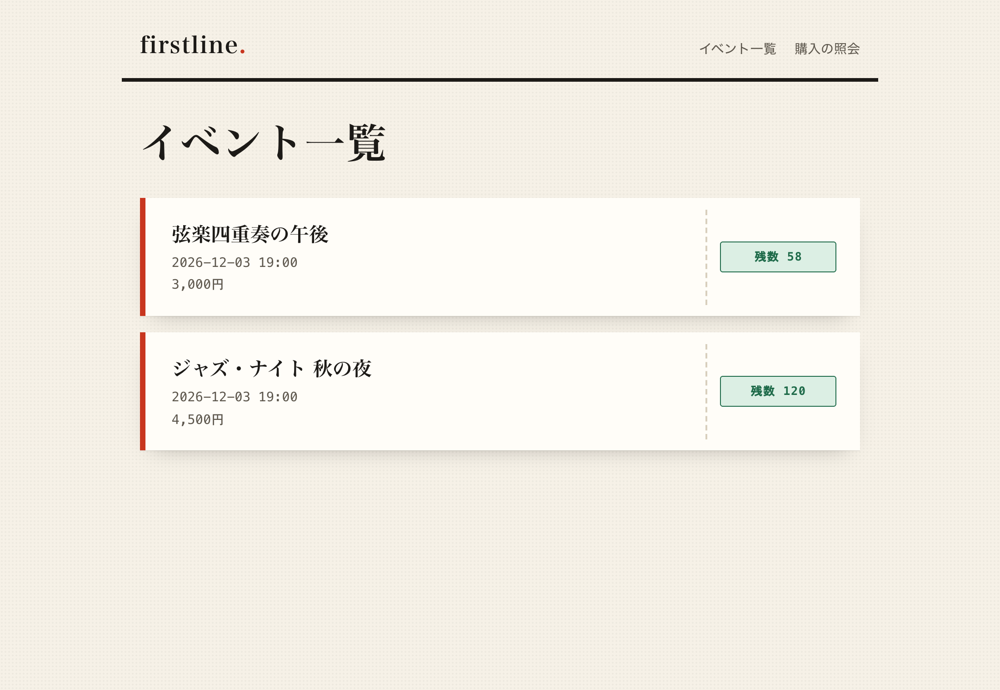
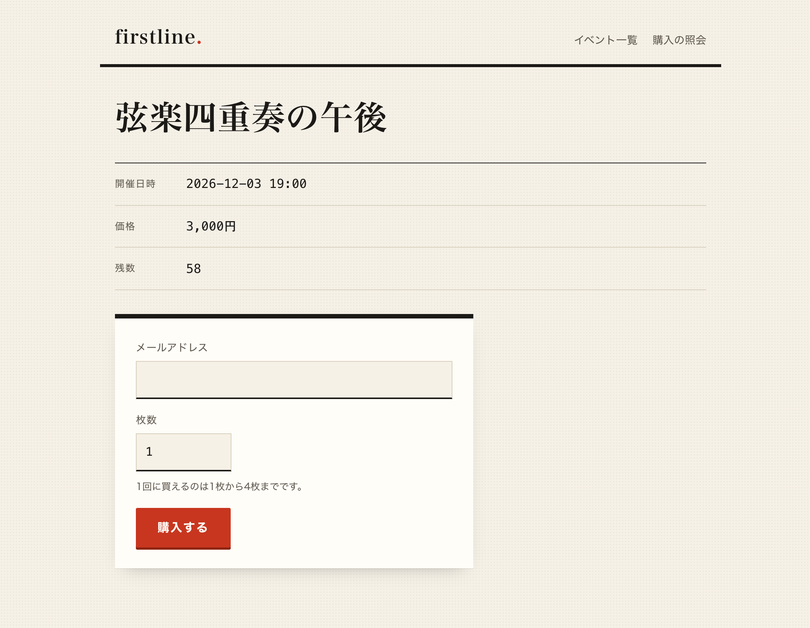
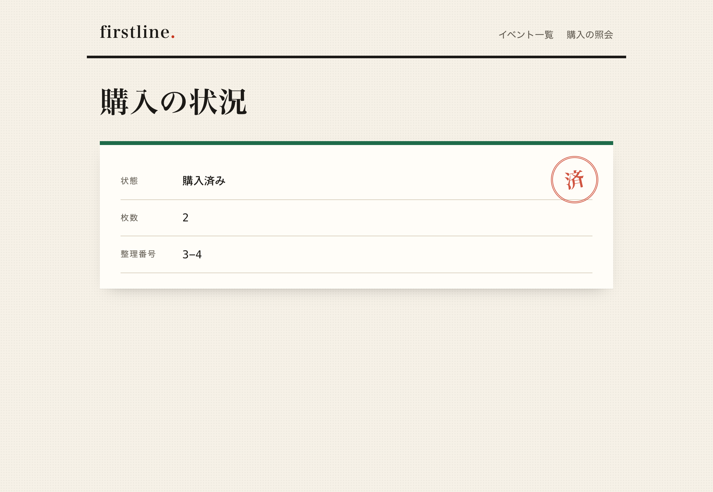
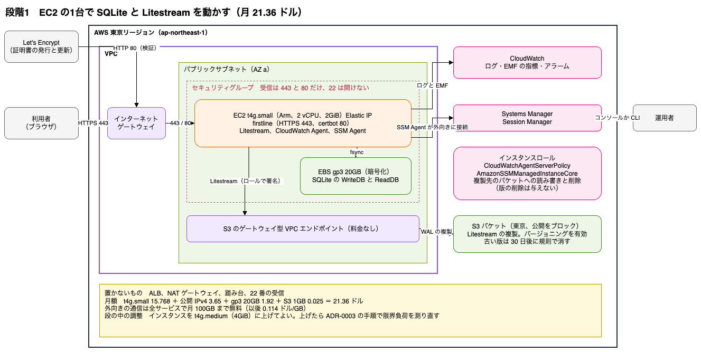

# firstline

firstlineは小規模なイベントやライブの先着チケットと整理券を売るWebサービスです。GoとSQLiteの単一バイナリで動き、規模が大きくなったらPostgreSQLかMySQLへデータを移せます。

販売開始の直後に購入が集中しても二重販売は起こりません。席の数はDBの条件付き更新で数え、購入の確定はfsyncの完了を待ってから応答します。保留の期限が切れた後に決済が完了した購入は、自動で払い戻します。

## 画面

購入者はログインせずに、イベントの一覧から席を保留して決済に進みます。

| イベント一覧 | イベントの詳細と購入 |
|---|---|
|  |  |

購入の状況の画面はhtmxで5秒ごとに状態を取り直し、決済が完了したら整理番号を表示します。

| 決済待ち | 購入済み |
|---|---|
|  |  |

主催者はログインしてイベントを作り、販売の状況を確かめます。

| 自分のイベント | 販売の状況 |
|---|---|
|  |  |

画面は日本語と英語に対応しています。言語はブラウザの`Accept-Language`で選び、決まらないときは日本語で表示します。

## 構成

firstlineは1台のホストで1つのプロセスとして動きます。DBへの書き込みは1つのゴルーチンにまとめ、同時に届いた書き込みを1回のfsyncでコミットします。読み取りは別の接続で行うので、書き込みの待ちに引きずられません。

| 部分 | 使うもの |
|---|---|
| 言語 | Go（標準の`net/http`と`html/template`） |
| DB | SQLite（`modernc.org/sqlite`、cgoなし）。PostgreSQLとMySQLにも同じ差し替え口で対応します |
| SQL | [Bun](https://bun.uptrace.dev/)の生SQL。方言ごとのSQLファイルを使います |
| 画面 | サーバーで描画し、部分の更新に[htmx](https://htmx.org/)を使います |
| 複製 | [Litestream](https://litestream.io/)で東京のS3へ送ります |
| 観測 | 構造化ログ、CloudWatchのEMF、`/healthz` |
| 状態遷移の検証 | TLA+の仕様をTLCで検証します |

決済とメールは差し替え口の裏にあり、今の実装は模擬実装です。模擬の決済は設定した遅延の後に完了か失敗を非同期で通知するので、鍵がなくてもすべての経路を試験で通せます。

配備先はAWSの東京リージョンのEC2の1台です。ロードバランサーとNATゲートウェイは最初から置かず、アクセスが増えた段階でRDS、ALB、ECS on Fargateを足していく方針です。段階ごとの構成と月額、3社を比べた結果は[ADR-0006](docs/design/adr/ADR-0006-cloud-and-staged-topology.md)にあり、図の元の`.drawio`は[docs/design/diagrams](docs/design/diagrams/)に置いています。



設計の詳細は[基本設計書](docs/design/basic-design.md)と[ADR](docs/design/adr/)に書いてあります。

## 自分のマシンで動かす

firstlineはHTTPSで待ち受けるので、証明書が要ります。主催者の追加はUnixソケットを使うため、LinuxかmacOSで動かしてください。

```sh
go build -o firstline ./cmd/firstline

mkdir -p tmp/run
openssl req -x509 -newkey rsa:2048 -nodes -days 30 -subj /CN=localhost \
  -keyout tmp/privkey.pem -out tmp/fullchain.pem

export FIRSTLINE_DB_PATH=$PWD/tmp/firstline.db
export FIRSTLINE_LOCK_PATH=$PWD/tmp/firstline.lock
export FIRSTLINE_ADMIN_SOCK=$PWD/tmp/run/admin.sock
export FIRSTLINE_TLS_CERT=$PWD/tmp/fullchain.pem
export FIRSTLINE_TLS_KEY=$PWD/tmp/privkey.pem
export FIRSTLINE_ADDR=:8443
export FIRSTLINE_BASE_URL=https://localhost:8443
export FIRSTLINE_TOKEN_KEY=$(head -c 48 /dev/urandom | base64)
export FIRSTLINE_METRICS=none

./firstline serve
```

別のターミナルで同じ環境変数を設定し、主催者を作ります。パスワードは標準入力から読みます。

```sh
printf 'a-long-password\n' | ./firstline create-organizer -email organizer@example.com
```

購入者の画面は`https://localhost:8443/`、主催者の画面は`https://localhost:8443/admin/login`にあります。`/healthz`を返すのは`127.0.0.1:9090`の待ち受けだけです。

設定の一覧は[deploy/firstline.env.example](deploy/firstline.env.example)にあります。本番の配備に使うsystemdのユニット、Litestream、CloudWatch Agentの設定も[deploy/](deploy/)に置いてあります。

## AWSに配備する

AWSの資源は[deploy/terraform](deploy/terraform/)のTerraformで作ります。対象はネットワーク、セキュリティグループ、インスタンスロール、バックアップのバケット、EC2、Elastic IP、CloudWatchのアラーム、通知のSNSです。

1. stateを置くバケットを一度だけ作ります。

   ```sh
   cd deploy/terraform/bootstrap
   terraform init
   terraform apply -var state_bucket=<stateのバケット名>
   ```

2. トークンの署名鍵をParameter StoreのSecureStringに登録します。鍵はAWS管理のキー`aws/ssm`で暗号化されるので、`--key-id`は付けません。ホストのロールはこの値を読めますが、`/firstline/`の外のパラメータは読めません。

   ```sh
   aws ssm put-parameter --type SecureString --name /firstline/token-key --value "$(openssl rand -base64 48)"
   ```

3. リリースのタグを付けて押します。GitHub Actionsが`firstline-<タグ>-linux-arm64.tar.gz`を作り、リリースに添えます。SHA-256はリリースノートとジョブのログに載ります。

   ```sh
   git tag v0.1.0
   git push origin v0.1.0
   ```

4. 本体を作ります。`domain`はAレコードを書くホスト名、`firstline_version`は手順3のタグ、`firstline_sha256`はリリースノートのSHA-256です。planに`must be replaced`や`destroy`が出ていないことを見てからapplyしてください。

   ```sh
   cd deploy/terraform
   terraform init -backend-config=bucket=<stateのバケット名> -backend-config=key=firstline.tfstate
   terraform plan -var backup_bucket=<バックアップのバケット名> -var alert_email=<通知先のメールアドレス> \
     -var domain=<ホスト名> -var firstline_version=v0.1.0 -var firstline_sha256=<SHA-256> -out=tfplan
   terraform apply tfplan
   ```

   EC2は最初の起動で`/usr/local/sbin/firstline-install`を動かします。このスクリプトはfirstline、Litestream、CloudWatch Agent、certbotを入れ、署名鍵をParameter Storeから読み、LitestreamとCloudWatch Agentを起動します。
5. `alert_email`に届くSNSの確認のメールのリンクを押します。押すまでアラームのメールは届きません。
6. 出力の`elastic_ip`を`domain`のAレコードに書きます。名前がこのアドレスを引けるようになると、15分ごとに動く`firstline-cert-init.timer`が証明書を取り、firstlineを起動します。
7. 受付を開く前に、[ADR-0003](docs/design/adr/ADR-0003-scale-out-criteria.md)の手順でこのホストの限界負荷を測ります。測った値を`-var limit_load_items_per_sec=<限界負荷>`に足してもう一度applyすると、規模拡大の判断のアラームができます。

新しい版に上げるときは、タグを付けてリリースを作り、Session Managerでホストに入って次を実行します。Terraformの`firstline_version`と`firstline_sha256`を変えてapplyしても、動いているホストは古い版のままです。この2つは最初の起動で1回だけ使われ、EC2を作り直さないよう変更を無視する設定にしているためです。`/etc/firstline/install.env`の`FIRSTLINE_VERSION`と`FIRSTLINE_SHA256`を新しいタグとSHA-256に書き換えてから、スクリプトを動かしてください。スクリプトは新しい版を入れてfirstlineを再起動します。`/etc/firstline/env`のうち書き換えるのは`FIRSTLINE_TOKEN_KEY`と`FIRSTLINE_BASE_URL`だけで、運用者が変えたほかの値は残ります。

```sh
sudo /usr/local/sbin/firstline-install
```

Terraformの`firstline_version`と`firstline_sha256`も同じ値に直しておいてください。user dataの変更は既存のホストに届かず、この値は作り直したホストが最初に入れる版として使われるだけです。署名鍵を替える手順も同じで、`aws ssm put-parameter --overwrite`で値を上書きしてからこのスクリプトを動かすだけです。

EC2とElastic IPには`prevent_destroy`を付けています。SQLiteのDBはEC2の起動ディスクにあるので、作り直しや削除を含むplanはTerraformがエラーで止めます。

## サブコマンド

| コマンド | 役割 |
|---|---|
| `serve` | HTTPS、運用者向けの待ち受け、主催者追加のソケットを開いて販売を受け付けます |
| `create-organizer` | 主催者を作ります。`serve`が動いていればソケット経由で頼み、止まっていればロックを取って直接書きます |
| `reconcile` | 決済の完了を突き合わせ、記録のない決済を払い戻します |
| `migrate-data` | SQLiteから空のPostgreSQLかMySQLへ全表を移し、行数と金額の合計を比べます |

## 試験

`scripts/check.sh`がすべての検証を順に流します。

```sh
bash scripts/check.sh
```

この中では次の検証が動きます。

- `go vet`、staticcheck、golangci-lint
- 単体試験（`-race`付き）と網羅率
- gremlinsによる変異試験
- CRAPの計算
- 文書の表記の検証
- 実際のバイナリを動かすE2E
- TLCによる状態遷移の検証
- Terraformの構成の検証（モックのプロバイダーを使うのでAWSの認証情報は要りません）
- ADR-0006と構成図の金額が計算のスクリプトの出力と一致するかの照合

PostgreSQLとMySQLの試験はtestcontainersでコンテナを起動するので、Dockerが要ります。TLCもJava 21入りのコンテナの中で動かすので、Javaを入れる必要はありません。
