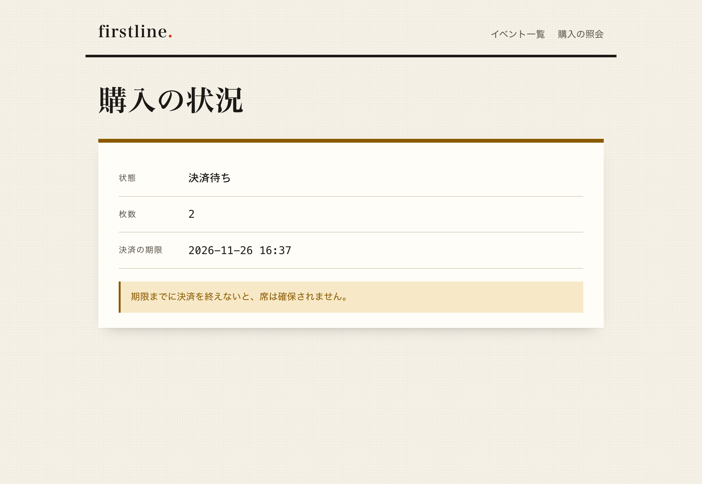
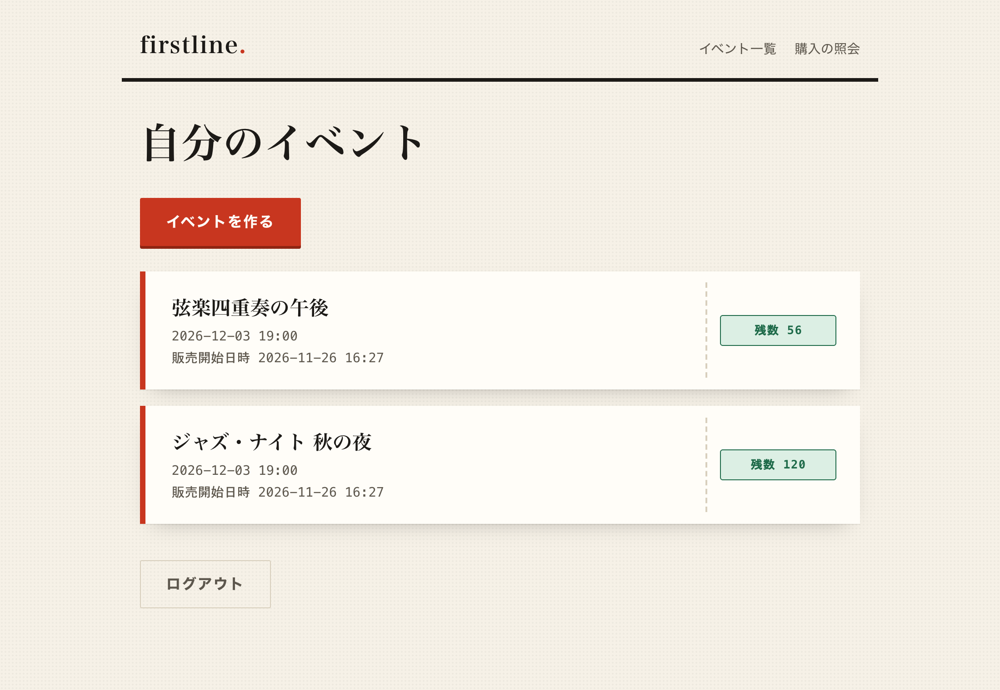
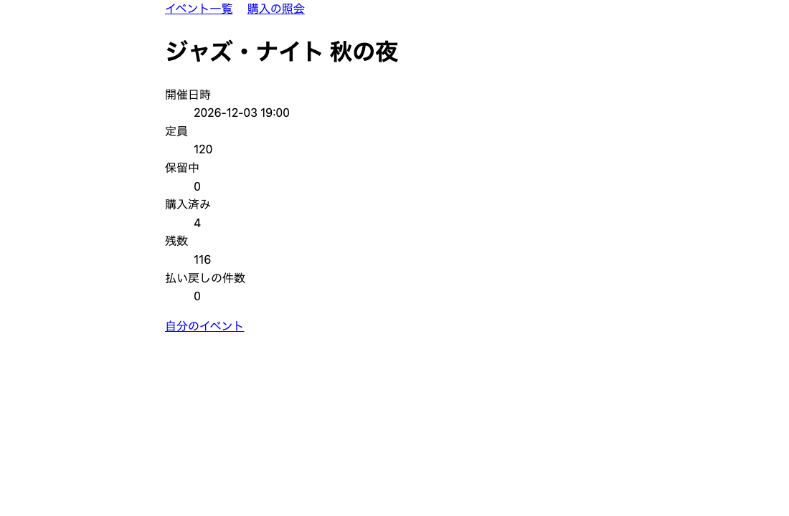

# firstline

firstlineは小規模なイベントやライブの先着チケットと整理券を売るWebサービスです。GoとSQLiteの単一バイナリで動き、規模が大きくなったらPostgreSQLかMySQLへデータを移せます。

販売開始の直後に購入が集中しても二重販売は起こりません。席の数はDBの条件付き更新で数え、購入の確定はfsyncの完了を待ってから応答します。保留の期限が切れた後に決済が完了した購入は、自動で払い戻します。

## 画面

購入者はログインせずに、イベントの一覧から席を保留して決済に進みます。

| イベント一覧 | イベントの詳細と購入 |
|---|---|
|  |  |

購入の状況の画面はhtmxで5秒ごとに状態を取り直し、決済が完了したら整理番号を表示します。

| 決済待ち | 購入済み |
|---|---|
|  |  |

主催者はログインしてイベントを作り、販売の状況を確かめます。

| 自分のイベント | 販売の状況 |
|---|---|
|  |  |

画面は日本語と英語に対応しています。言語はブラウザの`Accept-Language`で選び、決まらないときは日本語で表示します。

## 構成

firstlineは1台のホストで1つのプロセスとして動きます。DBへの書き込みは1つのゴルーチンにまとめ、同時に届いた書き込みを1回のfsyncでコミットします。読み取りは別の接続で行うので、書き込みの待ちに引きずられません。

| 部分 | 使うもの |
|---|---|
| 言語 | Go（標準の`net/http`と`html/template`） |
| DB | SQLite（`modernc.org/sqlite`、cgoなし）。PostgreSQLとMySQLにも同じ差し替え口で対応します |
| SQL | [Bun](https://bun.uptrace.dev/)の生SQL。方言ごとのSQLファイルを使います |
| 画面 | サーバーで描画し、部分の更新に[htmx](https://htmx.org/)を使います |
| 複製 | [Litestream](https://litestream.io/)でCloudflare R2へ送ります |
| 観測 | 構造化ログ、CloudWatchのEMF、`/healthz` |
| 状態遷移の検証 | TLA+の仕様をTLCで検証します |

決済とメールは差し替え口の裏にあり、今の実装は模擬実装です。模擬の決済は設定した遅延の後に完了か失敗を非同期で通知するので、鍵がなくてもすべての経路を試験で通せます。

設計の詳細は[基本設計書](docs/design/basic-design.md)と[ADR](docs/design/adr/)に書いてあります。

## 自分のマシンで動かす

firstlineはHTTPSで待ち受けるので、証明書が要ります。主催者の追加はUnixソケットを使うため、LinuxかmacOSで動かしてください。

```sh
go build -o firstline ./cmd/firstline

mkdir -p tmp/run
openssl req -x509 -newkey rsa:2048 -nodes -days 30 -subj /CN=localhost \
  -keyout tmp/privkey.pem -out tmp/fullchain.pem

export FIRSTLINE_DB_PATH=$PWD/tmp/firstline.db
export FIRSTLINE_LOCK_PATH=$PWD/tmp/firstline.lock
export FIRSTLINE_ADMIN_SOCK=$PWD/tmp/run/admin.sock
export FIRSTLINE_TLS_CERT=$PWD/tmp/fullchain.pem
export FIRSTLINE_TLS_KEY=$PWD/tmp/privkey.pem
export FIRSTLINE_ADDR=:8443
export FIRSTLINE_BASE_URL=https://localhost:8443
export FIRSTLINE_TOKEN_KEY=$(head -c 48 /dev/urandom | base64)
export FIRSTLINE_METRICS=none

./firstline serve
```

別のターミナルで同じ環境変数を設定し、主催者を作ります。パスワードは標準入力から読みます。

```sh
printf 'a-long-password\n' | ./firstline create-organizer -email organizer@example.com
```

購入者の画面は`https://localhost:8443/`、主催者の画面は`https://localhost:8443/admin/login`にあります。`/healthz`を返すのは`127.0.0.1:9090`の待ち受けだけです。

設定の一覧は[deploy/firstline.env.example](deploy/firstline.env.example)にあります。本番の配備に使うsystemdのユニット、Litestream、CloudWatch Agentの設定も[deploy/](deploy/)に置いてあります。

## サブコマンド

| コマンド | 役割 |
|---|---|
| `serve` | HTTPS、運用者向けの待ち受け、主催者追加のソケットを開いて販売を受け付けます |
| `create-organizer` | 主催者を作ります。`serve`が動いていればソケット経由で頼み、止まっていればロックを取って直接書きます |
| `reconcile` | 決済の完了を突き合わせ、記録のない決済を払い戻します |
| `migrate-data` | SQLiteから空のPostgreSQLかMySQLへ全表を移し、行数と金額の合計を比べます |

## 試験

`scripts/check.sh`がすべての検証を順に流します。

```sh
bash scripts/check.sh
```

この中では次の検証が動きます。

- `go vet`、staticcheck、golangci-lint
- 単体試験（`-race`付き）と網羅率
- gremlinsによる変異試験
- CRAPの計算
- 文書の表記の検証
- 実際のバイナリを動かすE2E
- TLCによる状態遷移の検証

PostgreSQLとMySQLの試験はtestcontainersでコンテナを起動するので、Dockerが要ります。TLCもJava 21入りのコンテナの中で動かすので、Javaを入れる必要はありません。
