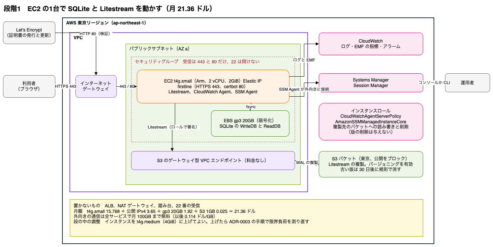
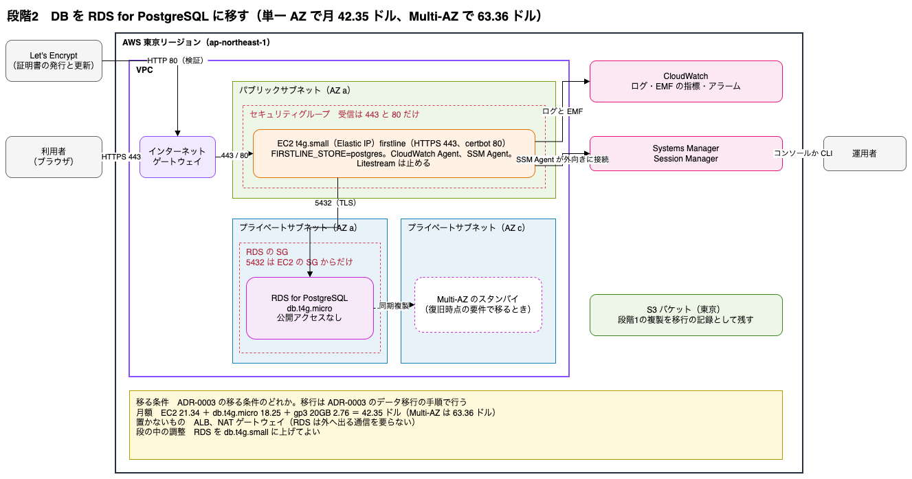
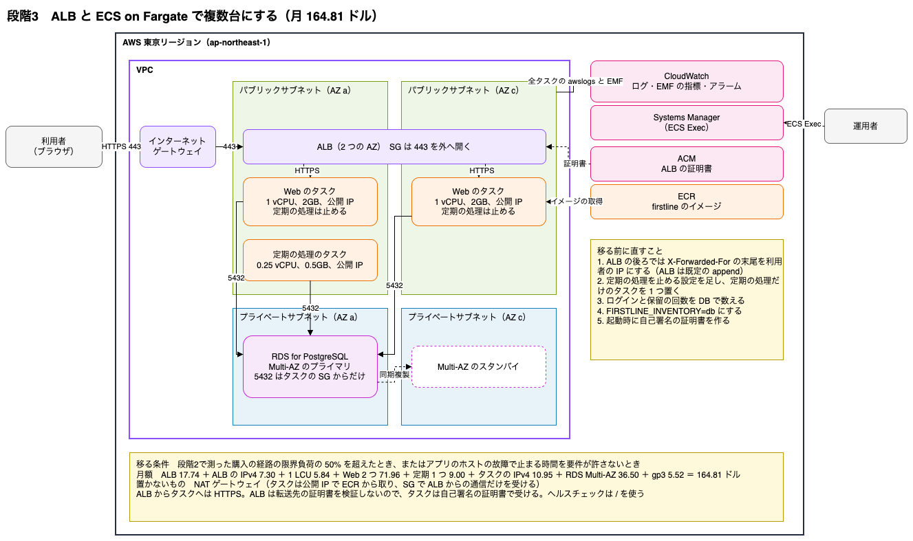

# ADR-0006 AWSのVMで始め、アクセスに合わせて構成を広げる

状態は採用です。

## 状況

firstlineは小さく始め、事業が伸びた時点で構成を分けていく方針です。ロードバランサーやAPI Gatewayは最初から置かず、実際のアクセスが増えた段階で足します。配備先はAWS、Google Cloud、Azureの3社から選びます。Cloudflareは独自のコンポーネントが多く、このアプリに合わないので候補から外しました。

比べる前提は利用者が決めました。地域は東京で、課金は従量だけです。初期の外向きの通信は月50GBほどで、1回の販売は数百席です。単価は2026年11月27日（JST）に各社の価格APIと料金表から取りました。AWSはPrice List、AzureはRetail Prices API、Googleは料金表の頁です。

## 決定

AWSの東京リージョン（`ap-northeast-1`）で、EC2の1台から始めます。構成は次の3つの段階で広げ、各段階の図を`docs/design/diagrams/`に置きます。段階の中で足りなくなったときは、構成を変えずにインスタンスやDBの種類を1段上げ、ディスクを広げてかまいません。種類を上げたときはADR-0003の手順で限界負荷を測り直し、ディスクを広げたときはADR-0003のDBの大きさの条件を広げた後の容量で判定します。

| 段階 | 構成 | 移る条件 | 月額の目安 |
|---|---|---|---|
| 1 | EC2の`t4g.small`の1台でfirstlineとLitestreamを動かす。SQLiteはEBSのgp3に置き、複製は東京のS3へ送る | 最初の構成 | 21.36ドル |
| 2 | 段階1のEC2からSQLiteとLitestreamを外し、RDS for PostgreSQLの`db.t4g.micro`を足す | ADR-0003の移る条件のどれか | 単一AZで42.35ドル。復旧時点の要件で移るときはMulti-AZで63.36ドル |
| 3 | ALB、ECS on FargateのArmのWebのタスク2つと定期の処理のタスク1つ、ECR、RDSのMulti-AZ | 段階2で購入の経路の限界負荷をADR-0003と同じ手順で測り、本番の`sync_items_per_sec_max_5m`がその50%を超えたとき。またはアプリのホストの故障で止まる時間を要件が許さなくなったとき | 164.81ドル |

月額は外向きの通信を含みません。AWSの外向きの通信は全サービスの合計で月100GBまで無料で、その先は東京から1GBあたり0.114ドルです。段階1の50GBなら通信費はかかりません。月額に入れていない費用はほかに次のものがあります。

- CloudWatchの指標は[月10個まで無料](https://aws.amazon.com/cloudwatch/pricing/)です。段階1ではEMFの指標10個、エラーのメトリクスフィルタ1個、CloudWatch Agentのディスクの使用率1個で12個になり、超えた2個に月0.60ドルかかります。アラームは6個で、[月10個までの無料の枠](https://aws.amazon.com/cloudwatch/pricing/)に収まります。通知に使うSNSのメールも[月1,000件まで無料](https://aws.amazon.com/sns/pricing/)です。
- CloudWatch Logsの取り込みは月5GBまで無料で、超えた分は1GBあたり0.76ドルです。
- 段階3のECRの保管料は1GBあたり月0.10ドルです。
- Litestreamの要求の料金（下の「3社の比較」の節）と、古い版の保管料（「結果」の節）。

### 段階1 EC2の1台

ネットワークの方針は外から届く口を443番と80番の2つに絞ることです。保守のための口は開けません。

- パブリックサブネットを1つ置き、インターネットゲートウェイで外とつなぎます。NATゲートウェイとロードバランサーは置きません。
- セキュリティグループで受け付けるのは443番と、証明書の検証に使う80番だけです。22番は開けません。
- 保守には[Session Manager](https://docs.aws.amazon.com/systems-manager/latest/userguide/session-manager.html)を使います。受信ポートを開けず、踏み台やSSHの鍵も要らない方式で、EC2での利用に[追加の料金はかかりません](https://aws.amazon.com/systems-manager/pricing/)。
- Elastic IPを1つ付け、DNSのAレコードに使います。料金は公開IPv4と同じ1時間0.005ドルです。
- S3へは[ゲートウェイ型のVPCエンドポイント](https://docs.aws.amazon.com/vpc/latest/privatelink/vpc-endpoints-s3.html)を通します。料金はかかりません。
- LitestreamはインスタンスロールでS3へ書き、アクセスキーはホストに置きません。バケットは[バージョニング](https://docs.aws.amazon.com/AmazonS3/latest/userguide/Versioning.html)を有効にし、ロールには版を消す`s3:DeleteObjectVersion`とバケットの設定を変える権限を与えません。EC2が乗っ取られて上書きや削除をされても、前の版から30日の間は戻せます。

設定の詳細は基本設計書の「配備」の節にあります。

### 段階2 RDS for PostgreSQL

DBをRDSへ移す手順はADR-0003の「データ移行の手順」のとおりです。アプリは`FIRSTLINE_STORE=postgres`と`FIRSTLINE_DSN`に替えるだけで動き、コードは変えません。

- RDSはプライベートサブネットに置き、公開アクセスを切ります。RDSのサブネットグループには2つのAZのサブネットを入れます。
- RDSのセキュリティグループはEC2のセキュリティグループからの5432番だけを受け付けます。
- RDSは外へ出る通信を要らないので、この段階でもNATゲートウェイは置きません。
- SQLiteを外したEC2ではLitestreamを止め、S3の複製は移行の記録として残します。

### 段階3 ECS on FargateとALB

この段階で初めてロードバランサーを置きます。

- ALBはパブリックサブネットに置きます。443番を外へ開け、証明書はACMのものを使います。
- タスクはパブリックサブネットに置き、公開IPを付けます。ECRからの取得はインターネットゲートウェイを通るので、NATゲートウェイは要りません（[Fargateのタスクのネットワーク](https://docs.aws.amazon.com/AmazonECS/latest/developerguide/fargate-task-networking.html)）。
- タスクのセキュリティグループはALBのセキュリティグループからの通信だけを受け付けます。外から直接タスクへは届きません。
- ALBからタスクへの通信はHTTPSのままにします。[ALBは転送先の証明書を検証しない](https://docs.aws.amazon.com/elasticloadbalancing/latest/application/load-balancer-target-groups.html)ので、タスクは自己署名の証明書で受けられます。certbotとSIGHUPでの読み直しは、この段階では使いません。

公開IPを付ける形はタスクが増えるほど割に合わなくなります。タスク1つの公開IPは月3.65ドルです。プライベートサブネットへ移すときは、ECRの2つ、CloudWatch Logs、ECS Execに要る`ssmmessages`（[ECS Execの文書](https://docs.aws.amazon.com/AmazonECS/latest/developerguide/ecs-exec.html)）のインターフェース型のVPCエンドポイントを2つのAZに置くことになり、月81.76ドルかかります。タスクが22個までなら公開IPのほうが安く（22個で月80.30ドル）、23個で逆転します。それまではこの形を続ける判断です。

段階3に移る前に、今のバイナリを次のように直す必要があります。直さないまま図の構成にすれば制限と定期の処理が正しく動きません。

1. 利用者のIPアドレス firstlineは`RemoteAddr`だけを見ます（`internal/web/server.go`の`clientIP`）。ALBの後ろでは全員がALBのアドレスになり、IPアドレスごとの保留とログインの制限を全員で分け合います。ALBの`routing.http.xff_header_processing.mode`は既定の`append`のままにします。ALBは利用者のアドレスを[`X-Forwarded-For`の末尾に足す](https://docs.aws.amazon.com/elasticloadbalancing/latest/application/x-forwarded-headers.html)ので、ALBの後ろにいるときだけ末尾の値を使うよう直します。
2. 定期の処理 期限切れ、払い戻しの再試行、照合、メールの送信は、どのプロセスでも動きます。タスクが2つあると同じメールを2回送りえます。定期の処理を止める設定を足し、定期の処理だけを動かすタスクを1つ置きます。
3. 回数の制限 ログインと保留の回数はプロセスのメモリで数えます。タスクの数だけ上限が緩むので、DBで数える形へ移します。
4. 在庫 `FIRSTLINE_INVENTORY=db`に替えます。設定はすでにあります。
5. 証明書 firstlineは証明書をファイルから読むだけで（`internal/cli/tlsreload.go`）、作る処理を持ちません。タスクの起動時に自己署名の証明書を作り、`FIRSTLINE_TLS_CERT`と`FIRSTLINE_TLS_KEY`の場所に置く処理を、コンテナの起動スクリプトかバイナリに足します。期限の監視はACMが更新するALBの証明書で足りるので、タスクの`tls_cert_days_left`のアラームは使いません。

主催者を足すときはECS Execで1つのタスクに入り、そのタスクの中で`create-organizer`を実行します。ログはawslogsのログドライバーで、指標はCloudWatch Agentのサイドカーで送る構成です。ALBのヘルスチェックは[既定のパス](https://docs.aws.amazon.com/elasticloadbalancing/latest/application/target-group-health-checks.html)の`/`を使います。`/healthz`はループバックだけで待ち受けるので、ALBからは届きません。`/`の一覧の画面はDBを読むため、DBに届かないタスクはヘルスチェックで外れる仕組みです。

## 理由

### VMから始める理由

SQLiteのWALはDBを使うすべてのプロセスが同じホストにあることを求めます。[SQLiteの文書](https://www.sqlite.org/wal.html)は「WAL does not work over a network filesystem」と書いています。各社のコンテナの実行基盤を調べてもこの条件を満たす書き込み先はありません。

| 実行基盤 | 書き込み先 | SQLiteに使えない理由 |
|---|---|---|
| ECS on Fargate | タスクの一時領域、EBS、EFS | サービスが管理するタスクのEBSは[タスクの終了で必ず消えます](https://docs.aws.amazon.com/AmazonECS/latest/developerguide/ebs-volumes.html)。EFSはネットワークのファイルシステムです |
| Cloud Run | コンテナのファイルシステム、一時ディスク、Cloud Storage FUSE、NFS、SMB | ファイルシステムは[メモリの上にあり、インスタンスの停止で消えます](https://cloud.google.com/run/docs/container-contract)。[一時ディスク](https://cloud.google.com/run/docs/configuring/services/ephemeral-disk)もインスタンスの停止で中身が消えます。SMBはネットワークのファイルシステムです。[Cloud Storage FUSE](https://cloud.google.com/storage/docs/cloud-storage-fuse/overview)はファイルロックに対応せず、[NFSのマウント](https://cloud.google.com/run/docs/configuring/services/nfs-volume-mounts)はロックなしで動きます |
| Azure Container Apps | コンテナとレプリカの一時領域、Azure Files | 一時領域は[コンテナやレプリカの停止で消え、残るのはAzure Filesだけです](https://learn.microsoft.com/en-us/azure/container-apps/storage-mounts)。Azure FilesはSMBかNFSのネットワークのファイルシステムです |

コンテナに移すのはDBがRDSへ移ってアプリがファイルを持たなくなる段階3です。

### インスタンスの大きさ

2 vCPUと2GiBに制限したコンテナで、実際のバイナリとLitestream v0.5.18を動かして測りました。保留の作成4000件、ログイン300件、読み取り6000件を送ると、最大のRSSはfirstlineが355MB、Litestreamが41MBでした。このときのDBは2.6MBで、ReadDBのキャッシュはほぼ空です。ReadDBは接続8本がそれぞれ最大64MiBのキャッシュを持つので、DBが大きくなるとさらに最大512MiB増えます。CloudWatch AgentとOSを足すと1GiBでは足りないので、2GiBの`t4g.small`にしました。

### 3社の比較

段階ごとの月額を比べた結果です。この節の月額は`python3 scripts/cloud_costs.py`で計算し直せます。単位は米ドルで、1か月を730時間として計算しました。外向きの通信の量は10^9バイトを1GBとして与え、AWSとAzureには1GBあたりの単価をそのまま掛けました。GoogleのGiBあたりの単価は1GB＝0.931GiBとして換算しています。AzureのStandard SSDには容量の料金とは別に操作の回数の料金（E10で1万回あたり0.002ドル）がかかり、回数は使い方で決まるので表には含めていません。

| 段階 | AWS | Google Cloud | Azure |
|---|---|---|---|
| 段階1（2GiBのVM、20GBのディスク、公開IPv4） | 21.36 | 21.96 | 25.93 |
| 段階1の中で4GiBのVMと100GBのディスクに上げた場合 | 44.91 | 48.14 | 44.89 |
| 段階2の単一の構成（2GiBのVMと最小の管理されたPostgreSQL、20GB） | 42.35 | 36.58 | 47.65 |
| 段階2の冗長な構成 | 63.36 | 50.71 | 公式の値を取れず |
| 外向き500GBの通信費 | 45.60 | 29.22 | 44.00 |
| 外向き2000GBの通信費 | 216.60 | 182.89 | 209.00 |

計算に使った単価は次の表のとおりです。

| 項目 | AWS | Google Cloud | Azure |
|---|---|---|---|
| 2GiBのVM | `t4g.small` 0.0216/時 | `e2-small` 0.02149143/時 | `B1ms` 0.0272/時 |
| 4GiBのVM | `t4g.medium` 0.0432/時 | `e2-medium` 0.04298286/時 | `B2pls v2` 0.0432/時 |
| 公開IPv4 | 0.005/時 | 0.005/時 | Standard 0.005/時 |
| ディスク | gp3 0.096/GB月 | pd-balanced 0.13/GiB月 | Standard SSDのE4（32GiB）2.4/月、E10（128GiB）9.6/月 |
| 最小の管理されたPostgreSQL | `db.t4g.micro` 0.025/時、Multi-AZ 0.05/時、gp3 0.138/GB月（Multi-AZは0.276） | `db-f1-micro` 0.014/時、HA 0.0273/時、SSD 0.221/GiB月（HAは0.442） | Flexible Serverの`B1ms` 0.026/時、0.138/GB月 |
| 外向きの通信 | 月100GBまで無料、以後0.114/GB | Standard Tierは月200GiBまで無料、以後0.11/GiB | 月100GBまで無料、以後0.11/GB（Routing Preference: Internet） |

段階3のAWSの164.81ドルの内訳は次のとおりです。

- ALBの時間料金が17.74ドル、2つのAZの公開IPv4が7.30ドル、1 LCUが5.84ドルです。
- FargateのArmのWebのタスク（1 vCPU、2GB）2つが71.96ドル、定期の処理のタスク（0.25 vCPU、0.5GB）1つが9.00ドルで、3つの公開IPv4が10.95ドルです。
- RDSの`db.t4g.micro`のMulti-AZは36.50ドルで、20GBのgp3が5.52ドルです。

GoogleとAzureの段階3は比べていません。Cloud Runの独自ドメインの割り当ては[Preview](https://cloud.google.com/run/docs/mapping-custom-domains)で、Googleの文書は本番に勧めていません。本番ではGoogleもロードバランサーを置くことになります。

Litestreamがファイルを書く（PUTの要求を送る）のは、[DBが変わった同期のときだけ](https://litestream.io/how-it-works/)です。書き込みが1か月ずっと続いて毎秒1回書いた場合、上の階層へのまとめ直しを足しても、S3のPUTの料金は730時間で月12.81ドルです。一方で片付けとまとめ直しのための一覧の要求は、書き込みのある間は送り続けます。Litestream v0.5.18を毎秒1回書き込むDBで動かして数えると、階層0が1時間に480回、階層1が375回でした。書き込みが1か月続くとこの一覧の料金は月2.93ドルです。1回の一覧の要求で返るキーは1000個までなので、片付けの前にファイルが溜まると要求の回数はこれより増えます。

### 各社の利点

AWSの利点は次のとおりです。

- 段階1の月額が3社でいちばん安くなります。
- 観測の実装（EMFの指標、CloudWatch Agent、CloudWatchのアラーム）と配備のファイルが、すでにAWS向けにできています（ADR-0005）。
- Session ManagerとS3のゲートウェイ型のVPCエンドポイントには料金がかからないので、保守の口とバックアップの経路をただで閉じられます。

Google Cloudの利点は次のとおりです。

- Standard Tierの外向きの通信が月200GiBまで無料で、500GBで月16.38ドル、2000GBで月33.71ドルAWSより安くなります。ただし[Standard Tierは公衆インターネットを通る経路](https://cloud.google.com/vpc/network-pricing)で、Googleは品質がPremium Tierより低いと書いています。既定のPremium Tierには無料の枠がなく、アジア向けは1GiBあたり0.12ドルです。
- 最小の管理されたPostgreSQLが安く、冗長な構成で月12.65ドル差があります。ただし`db-f1-micro`は共有コアで、`db.t4g.micro`と同じ性能とは限りません。
- [Cloud Logging](https://cloud.google.com/stackdriver/pricing)はプロジェクトごとに月50GiBまで取り込みが無料です。CloudWatch Logsの無料の枠は月5GBです。

Azureの利点は次のとおりです。

- 段階1の中で4GiBのVMに上げた場合は、AWSより月0.02ドル安くなります。
- 新しいアカウントは12か月の間、`B1s`、`B2pts v2`、`B2ats v2`を[それぞれ月750時間まで無料](https://azure.microsoft.com/en-us/free/free-account-faq/)で使えます。ただしどれもメモリが1GiB以下で、firstlineには足りません。
- Armの1GiBのVM（`B2pts v2`）は0.0108/時で、AWSの`t4g.micro`と同じ単価です。

### AWSを選んだ理由

段階1ではAWSがいちばん安く、段階1の中で4GiBに上げてもAzureとの差は0.02ドルです。一方で段階2に移った後や外向きの通信が増えた後では、Standard Tierを使うGoogleのほうが月6ドルから34ドル安くなります。利用者はこの差と観測の実装や配備のファイルを作り直す手間を比べ、AWSを選びました。Azureは2GiBの段階1と段階2の単一の構成で最も高く、冗長なPostgreSQLの料金は公式の値を取れませんでした。

## 結果

受け入れる制約は次のとおりです。

1. 外向きの通信が増えるほど、Standard Tierを使うGoogleとの月額の差が開きます。外向きの通信が月500GBを超えたら、この比較の単価を取り直して計算し直してください。
2. 段階3に移る前に「段階3 ECS on FargateとALB」の節に書いた改修を終えておく必要があります。
3. バージョニングで古い版を30日残すので、その分の保管料がかかります。1日に1つのスナップショットは30日分残るので、DBが1GBなら30GBで月0.75ドルです。これに、Litestreamが消したLTXのファイルが30日分足されます。この量はDBの大きさでなく書き込みの量で決まります。21MBのDBに毎秒1回書き込んで測った大きさから計算すると、書き込みが30日続いたときは約35.4GBで、月0.88ドルです。
4. 単価は2026年11月27日の値です。段階を移るときは、その時点の単価で月額を計算し直します。

この決定に従う箇所はADR-0001の複製先と、基本設計書の「配備」の節にあるネットワークと権限の表、その表を作る`deploy/terraform`です。
